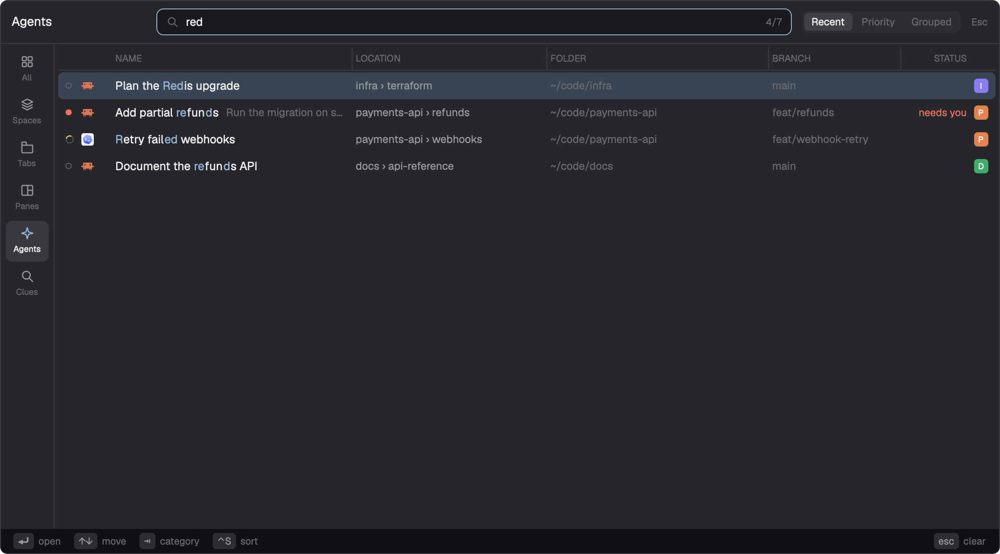

<p align="center">
  
</p>

<h1 align="center">herdr-recall</h1>

<p align="center"><strong>那個 agent 剛剛在哪個 tab？</strong></p>

<p align="center">
  <a href="https://herdr.dev/"></a>
  <a href="LICENSE"></a>
</p>

<p align="center">
  <a href="README.md">English</a> ·
  <b>繁體中文</b>
</p>

[Herdr](https://herdr.dev/) app 的 IntelliJ 風格「Recent」切換器。一個鍵列出所有 space、tab、pane 與 agent，最近用過的排最前面，並停在你上一個待過的位置：按 `⌘E` 再按 `⏎`，就回到剛剛待的地方。從沒去過的排在去過的後面，等你處理的排最前（依序是 blocked、done、working、idle）。



每一列都標出它在哪、所在資料夾、branch，以及那裡的 agent 是否在等你。打字即可模糊搜尋，拖曳欄位邊緣可以調整寬度。

第一個清單 **All** 把所有 space、tab、pane 與 agent 放在一起，不必先知道要找的是哪一種。每個名稱前面都帶著它的路徑（`payments-api › refunds › nvim`），每個目的地也只出現一次：agent 代表它所在的 pane，tab 要有好幾個 pane 才會有自己的一列，space 要有好幾個 tab 才會有。agent 與 pane 排最前面，接著是 tab，最後是 space，各自依最近用過的順序排列；從沒去過的排在後面，等你處理的排最前。打字只會縮小這份清單。

最後一個清單 **Clues** 能用 pane 正在跑的指令、ssh 連到的主機、開著的檔案、監聽的 port，或印出過的文字找到它：輸入 `port 5173` 就能找到啟動 dev server 的那個 pane。為此 Recall 會在你的電腦上執行 `git`、`ps`、`lsof` 並讀取 pane 的內容，資料不會離開你的電腦。

## Install

Recall 需要 Herdr app，而且 `herdr-app` 要在 `PATH` 上。

**請 agent 安裝。** 請 Herdr 裡的 agent 加入 `github.com/shihyuho/herdr-recall` 這個 mod。它會把 `mods/recall/` 複製到位、把 [`keys.json`](keys.json) 裡的 `⌘E` 加進你的按鍵設定（如果你已經在用這個鍵，會先問你），並執行 `herdr-app check`。

**用腳本安裝。** 需要 `rsync`。

```bash
git clone https://github.com/shihyuho/herdr-recall.git
cd herdr-recall
./install.sh
```

接著在 `~/.config/herdr-app/keys.json` 綁定按鍵：

```json
{
  "global": {
    "cmd-e": "mod.open:recall"
  }
}
```

`cmd-e` 在 macOS 上就是 `⌘E`；其他系統請挑一個還沒用到的鍵。

**不論用哪種方式，** 先按一次那個鍵。這會啟動 Recall 的 tracker，從此記錄每一次切換焦點，之後每次啟動 Herdr 都會自動帶起來。

**更新：** pull 這個 repo（或重新 clone），再重新執行 `./install.sh`。它會取代 `mods/recall/`，使用紀錄和欄位寬度都會保留，因為 Herdr 把它們存在那個資料夾之外。用 agent 安裝的話，請 agent 幫你做這兩步：Herdr 規定 agent 不能覆蓋已經存在的 mod，所以再請它「加入這個 mod」只會多出一份改了名字的複本，不會更新。

要移除 Recall，刪掉 `~/.config/herdr-app/mods/recall`，再拿掉綁給它的按鍵。

<details>
<summary><strong>按鍵與滑鼠</strong></summary>

| 按鍵 | 作用 |
| --- | --- |
| `⏎` | 前往這一列 |
| `↑` `↓`、`⌃P` `⌃N` | 移動 |
| `⇥` `⇧⇥` | 下一個／上一個分類 |
| `⌃S` | Agents：依最近、優先度或分組排序 |
| `Esc` | 先清掉搜尋，再關閉 |
| `⌃C` | 關閉 |

| 滑鼠 | 作用 |
| --- | --- |
| 點一列 | 前往那裡 |
| 點左側的分類 | 切換過去 |
| 拖曳欄位標題左邊的分隔線 | 調整那一欄的寬度；在分隔線上雙擊可以還原 |

再按一次開啟的按鍵會關閉切換器；如果那個按鍵開的是別的分類，就切換過去。欄位寬度會記住。

</details>

<details>
<summary><strong>可綁定的指令</strong></summary>

| 指令 | 作用 |
| --- | --- |
| `recall.open` | 開在上次用的分類 |
| `recall.open-<category>` | 開在 `all`、`spaces`、`tabs`、`panes`、`agents` 或 `clues`（`others` 也會開 Clues） |
| `recall.open-agents-<sort>` | 開在 agents，依 `recent`、`priority` 或 `grouped` 排序 |
| `recall.previous-tab` | 跳回上一個 tab，可跨 space |
| `recall.previous-pane` | 跳回上一個 pane |
| `recall.previous-agent` | 跳回上一個 agent |
| `recall.previous-space` | 跳回上一個 space |

綁定方式和上面的 `mod.open:recall` 一樣寫在 `keys.json`。這些指令要等 tracker 啟動後才有作用，也就是第一次打開切換器之後。

</details>

<details>
<summary><strong>在 Clues 裡搜尋</strong></summary>

一般的搜尋會比對 pane 正在跑的東西、它的位置，以及它印出過的文字。前綴加一個空格可以縮小範圍：

| 前綴 | 用什麼找 pane |
| --- | --- |
| `cmd ` | 正在執行的指令 |
| `ssh ` | ssh 連到的主機 |
| `cwd ` | 工作目錄 |
| `file ` | 執行編輯器的 pane 裡的文字；單獨輸入時，列出各自開著的檔案 |
| `term ` | 一般終端機 pane 裡的文字 |
| `port ` | 它的 shell 底下的程序所監聽的 port |
| `pid ` | 它的 shell 所啟動的程序的 process ID |
| `.` | 只比對印出過的文字 |

`ws `、`tab `、`pane ` 會切換到對應的清單。

</details>

<details>
<summary><strong>設定</strong></summary>

`~/.config/herdr-app/recall.json` 的每個欄位都可省略：

```json
{
  "tabs": ["all", "spaces", "tabs", "panes", "agents", "clues"],
  "keybindings": {
    "move_up": ["k", "up"],
    "move_down": ["j", "down"]
  }
}
```

- `tabs`：要顯示哪些分類，以及它們的順序。切換器會開在上次用的分類，沒有的話就是第一個。`others` 是 herdr-recent-navigator 的叫法，等同 `clues`。
- `keybindings`：`next_category`、`previous_category`、`move_up`、`move_down`、`select`、`dismiss`、`force_quit`、`backspace`。像上面這樣把移動鍵綁成字母，就會切換成 vim 式輸入：`j` `k` 移動，`h` `l` 切換分類，`/` 開始搜尋。
- 按鍵可以用 Herdr 的寫法（`ctrl-p`、`shift-tab`），也可以用 herdr-recent-navigator 的寫法（`C-p`、`S-Tab`），所以那邊的設定可以直接搬過來用。

</details>

## Support

如果 herdr-recall 對你有幫助，可以透過 [Buy Me a Coffee](https://buymeacoffee.com/methodho) 支持它的維護。

## License

[MIT](LICENSE) © Shihyu Ho
