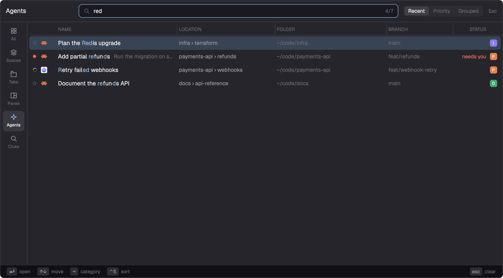

# Recall

One key lists your spaces, tabs, panes and agents, most recently focused first, and opens on the one you were in just before this one, so Enter takes you back. Each row shows where it lives, its folder, its branch and whether an agent there needs you. An All list finds a pane by what it runs, its ssh host, folder, port, process or the text it printed. This is a dialog you add to your current layout, not a layout of its own.



This file is the brief: enough to build Recall from an empty folder. The files next to it are one build of it. If they don't work on your Herdr, or you want it different, build it again from here.

## What you see

- A dialog in the middle of the window, 74% of its width and 70% of its height, on the theme's popover background. Text is 13px in the theme's foreground.
- **Header**, 48px high with a bottom border: the category's title on the left (150px, 14px semibold: "Recent Spaces", "Recent Tabs", "Recent Panes", "Agents", "Find Anywhere"), then a search field filling the rest (30px high, radius 8, a search icon, the row count on the right as `7` or `3/7` while searching; its border is the accent color while you type). On Agents, a segmented control follows: Recent, Priority, Grouped. "Esc" sits at the far right.
- **Rail** on the left, 60px wide with a right border: one 48×46 entry per category (Spaces, Tabs, Panes, Agents, All), a 16px icon over a 9.5px label. The current one has the selected background and an accent icon.
- **Table** filling the rest:
  - A 26px column head in 10.5px semibold capitals: NAME, LOCATION (CONTENTS on Spaces), FOLDER, BRANCH, STATUS. The column being sorted by is in the accent color with ▲ or ▼. A 1px divider sits left of every head but NAME.
  - Rows 30px high, radius 6. The selected row has the theme's selection background. Left to right:
    - the status glyph;
    - the program's icon in a 30px column (on All, a colored source label instead: `cmd`, `ssh`, `cwd`, `file`, `term`, `port`, `pid`);
    - the name, with matched letters in the accent color and semibold, and the row you are in now semibold. An agent's last message follows in dim 12px;
    - location ("space › tab") in muted 12px, folder and branch in dim 12px;
    - "needs you" (blocked color) or "finished" (done color) right-aligned in STATUS;
    - a 16px space badge: the space's first letter, white and bold, on the space's color.
  - The name takes what the other columns leave. Defaults are LOCATION 210px, FOLDER 240px, BRANCH 140px, STATUS 70px.
  - A linked worktree's space sits indented under its main checkout and reads "repo ⎇ branch".
  - Empty states read "Reading panes…", "Nothing matches" or "Nothing here yet".
- **Footer**, 28px high on the chrome background with a top border: the keys worth knowing now as small key chips with dim labels (`⏎ open`, `↑↓ move`, `⇥ category`, `⌃S sort` on Agents, `esc close` at the right). A broken `recall.json` shows its error here in the blocked color.

## How it behaves

- **Opening.** It opens on the category asked for, else the one used last, else the first. The selection starts on the first row that isn't where you are now, so Enter goes back. It keeps aiming there until you move, because focus can settle after the first frame. Pressing the open key again closes it.
- **Keys.**

  | Key | Action |
  | --- | --- |
  | Enter | Go to the row: `space.select`, `tab.select` + `pane.focus`, or `agent.focus` |
  | Up / Down, Ctrl+P / Ctrl+N | Move, wrapping around |
  | Tab / Shift+Tab | Next / previous category |
  | Ctrl+S | Agents only: cycle Recent, Priority, Grouped |
  | Escape | Clear the search, then close |
  | Ctrl+C | Close |

  Typing searches. Binding a movement key to a letter in `recall.json` turns on vim-style input: `j` `k` move, `h` `l` switch categories, `/` starts searching, and Escape leaves the search first.
- **Mouse.**
  - Click a row to go there, or a rail entry to switch category.
  - Click a column head to sort: ascending, then descending, then back to the category's own order. The selected row stays selected, a worktree moves with its main checkout, and empty values sort last. The sort lasts while the dialog is open.
  - Drag the divider left of a head to resize that column, between 48px and 520px; the name column gives or takes the difference, so the divider stays under the pointer. Double-click the divider to restore its default. Widths are kept for next time.
- **Agent status.**
  - working: a spinner in the working color;
  - blocked: a ● in the blocked color, plus "needs you";
  - done: a ● in the done color, plus "finished";
  - idle: a ○.

  Agents sort by Recent (last focused first), Priority (blocked, done, working, idle; latest change first within each) or Grouped (Herdr's own space, tab and pane order).
- **Search.** Fuzzy, every term matching some field:
  - spaces by name, folder and branch;
  - tabs by name, what they run, their space and their panes;
  - panes and agents by name, "space › tab", folder and program.

  On All:
  - a plain query also finds text panes printed;
  - a prefix and one space narrows it: `cmd`, `ssh`, `cwd`, `file`, `term`, `port`, `pid`;
  - `.` searches only printed text;
  - `ws`, `tab` and `pane` switch to those lists.

  All re-reads what panes run every 10 s and the buffers of new panes every 30 s while it shows.
- **Jumping back without the dialog.** `recall.previous-tab`, `-pane`, `-agent` and `-space` go to the most recently focused one that still exists and isn't where you are, across spaces.

## Built from

- **One mod**, `mods/recall/`:
  - `mod.json`: `{ "place": "none", "title": "Recall", "overlay": { "kind": "dialog", "width": 0.74, "height": 0.7 } }`;
  - `main.js`: the view and its state;
  - `ui.js`: the drawing;
  - `lib/`: pure functions, tested with `node --test 'tests/*.test.mjs'`:
    - `items.js` for the rows of each category;
    - `all.js` and `others.js` for All;
    - `fuzzy.js` for search;
    - `mru.js` for recency;
    - `config.js` for `recall.json`;
    - `columns.js` for location text, sorting and widths;
    - `worktrees.js` for worktree grouping;
  - `icons/`: `spaces`, `tabs`, `panes`, `agents`, `all` and `search` SVGs.
- **Two roles of one mod**, told apart by `props().role`:
  - **The tracker** is a kept, frameless 1×1 window (`key: "recall-tracker"`, `keep: true`). Its render records every focus change, as space, tab, pane and agent, into shared `recall.history`. It answers `recall.open`, `recall.open-<category>`, `recall.open-agents-<sort>` and `recall.previous-*` from `nextCommand()`.
  - **The navigator** is the dialog. Opening it opens the tracker, so one open starts tracking.
- **A `keys.json` snippet**, merged into the person's keys:

  ```json
  { "global": { "cmd-e": "mod.open:recall" } }
  ```

- **`herdr` functions:** `spaces`, `panes`, `agents`, `terminals`, `focused`, `theme`, `props`, `run`, `shared`, `setShared`, `openOverlay`, `closeOverlay`, `nextCommand`, `home`, `appHome`, `readTextFile`, `exec`, `hc`.
- **Commands run:** `space.select`, `tab.select`, `pane.focus`, `agent.focus`.
- **Shared state:**
  - `recall.history`: recency;
  - `recall.open`: the open dialog's heartbeat, every 1.5 s;
  - `recall.last`: the last category;
  - `recall.columns`: column widths;
  - it reads `space.colors`, as Herdr's own mods keep it, so badges match the sidebar.
- **Programs run** (all local; nothing reaches the network):
  - `git -C <folder> rev-parse --path-format=absolute --show-toplevel --git-common-dir` for each local space, to find worktrees;
  - for All: `hc get <t> --json` and `hc read <t> --lines 3000` for each terminal, `ps -eo pid=,ppid=,command=`, and `lsof -nP -iTCP -sTCP:LISTEN -F pn` (else `/usr/sbin/lsof`).
- **Settings:** `~/.config/herdr-app/recall.json`, optional:
  - `tabs`: which categories show, in order;
  - `keybindings`: `next_category`, `previous_category`, `move_up`, `move_down`, `select`, `dismiss`, `force_quit` and `backspace`, each a list of keys in Herdr's spelling or `C-p` / `S-Tab` style.
- **Art:** the six icons above, and the spinner from the shipped `mods/workspace-chrome/spinner.svg`.

## Watch out

- **Install by copying the folder, not symlinking it.** Herdr loads a mod's icons only from inside its home folder, so a symlinked copy runs without icons.
- **Copies of a mod share no memory.** The dialog announces itself in shared `recall.open` with a heartbeat. A second open within 4 s is a toggle, and a crash leaves nothing stuck.
- **The search field takes keys before `on_key_down` does,** and so does Tab focus traversal. Bind the category and close keys with `cx.bind_keys` in both `RecallNavigator` and `RecallNavigator > Input`, and handle them with `on_action`. Printable keys stay with `on_key_down`, since whether they type or move depends on the mode.
- **Focus the search field again 250 ms after opening.** The first focus can be lost.
- **Use `v_virtual_list` with a 30px row size and `track_scroll`, not `uniform_list`.** A `uniform_list` ignores `track_scroll` (`herdr-app check` warns about it), so `scroll_to_item` does nothing and a selection moved past the visible rows goes off screen.
- **The dialog only hears pointer moves while the pointer is over it.** A column resize ends when the pointer leaves the dialog.
- **The tracker only records from its first open.** Recency starts empty after installing.
- **The dialog's size is fixed by `mod.json`.** Check that the default column widths leave the name room on a small window.
- **Disclose before installing:** the mod runs programs (`exec`, `hc`) and reads terminal buffers. It reads nothing outside the app home besides what those programs report.

## Done when

- `herdr-app check mods/recall` passes, and `node --test 'tests/*.test.mjs'` passes.
- After the first `⌘E`, going from tab A to tab B and pressing `⌘E` opens with A's row selected, and Enter returns to A. Pressing `⌘E` twice closes the dialog.
- `recall.previous-tab` jumps back to the previous tab even when it is in another space.
- On Agents, a blocked agent reads "needs you" and Ctrl+S cycles Recent, Priority and Grouped.
- Clicking NAME sorts ▲, again ▼, and a third time restores recency, with the same row still selected.
- Dragging LOCATION's divider widens it; the width is still there after reopening, and a double-click restores 210px.
- In All, `port <n>` for a running dev server lists the pane that started it.
